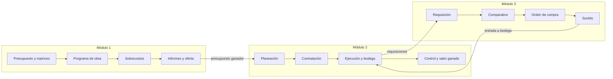
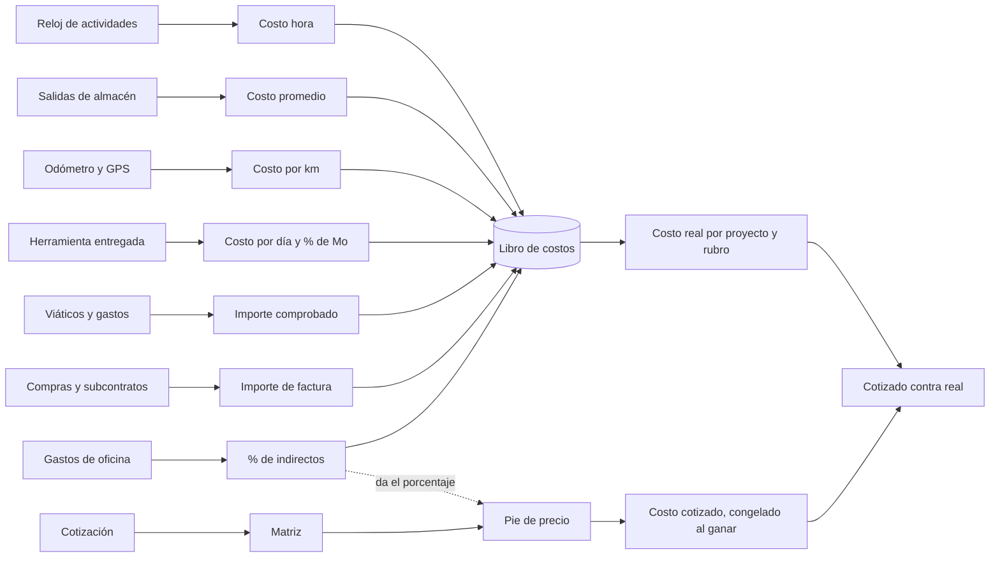
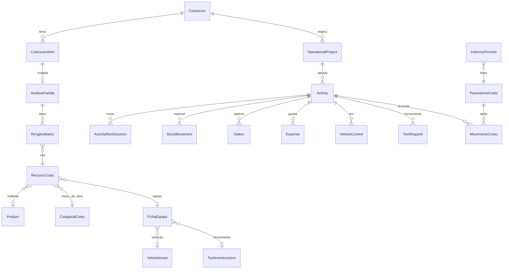

# Libro de costos: precios unitarios para NEXARA

Propuesta del 01-11-2026. Adam aprobó las Fases 0 y 1 ese mismo día y están construidas (ver «Estado»).
Las Fases 2 a 8 siguen en propuesta: no se construyen sin su visto bueno.

**En una frase:** cada cotización se arma con una matriz de lo que de verdad cuesta (equipo, técnicos, camioneta,
herramienta y oficina), y cada proyecto muestra lo gastado contra lo cotizado, casi al día.

Este repositorio es público: aquí no van sueldos, montos ni conteos de producción. La medición con datos reales, los
mockups y la investigación con diagramas están en el artifact privado que se le entregó a Adam (ver `.ai/RELEVO.md`).

## Estado

**Fase 0, motor y tarifas:** `apps/api/src/costos/calculos/` y `/erp/costos/tarifas`. **Fase 1, horas a proyecto:** libro de
costos, proceso nocturno, `/erp/costos`, `/erp/costos/proyectos` y la pestaña Costos de cada proyecto.

Cómo quedó, y en qué cambió respecto a la propuesta:

- **Ligar no toca la actividad.** La liga vive en `costo_actividad_ligas`. Así ligar no mueve el avance del proyecto ni el
  reporte de Contabilidad. Una actividad cuenta para un proyecto si su `projectId` lo dice, si su `cotizacionId` es la del
  proyecto, o si se ligó en la bandeja.
- **«Marcar cotización como ganada» no cambia su estado.** `POST /cotizaciones/:id/aprobar` tiene efectos (la manda a Por
  facturar, suma en BI) y hoy ninguna pasa por «enviada». Lo que hace ganadora a una cotización para Costos es que nazca un
  proyecto de ella: `/erp/proyectos/nuevo?cotizacionId=…`. Lo gastado en la cotización pasa solo a ese proyecto.
- **Dos tablas más:** `costo_personas` (categoría y cuotas propias) y `costo_actividad_ligas`. La Fase 0 quedó en 4 tablas y la
  1 en 2. El nombre en Prisma lleva el prefijo `Costo`: `CostoParametros`, `CostoCategoria`, `CostoFichaEquipo`, `CostoMovimiento`.
- **El reloj no se cobra en bruto:** si el sistema cerró la sesión (`TOPE_12H`, `CORTE_DIA`) cuenta a lo mucho una jornada, y dos
  relojes encimados de la misma persona se reparten. Ver `horasEfectivas`.
- **Viáticos:** lo comprobado; si no, lo aprobado. Lo pendiente o rechazado no es costo. Gasolina y casetas van a Vehículos.
- **`CostoMovimiento` no se audita** (`AUDIT_EXCLUDED`): se deriva de otras tablas y se recalcula de noche.
- **Vehículos y herramienta:** ya se les saca tarifa, pero aún no se cargan a los proyectos. Eso es de las Fases 3 y 4.
- **Horas extra:** aún no entran, porque `overtime_approvals` y `nomina_semanas` están vacías en producción. Cuando haya datos, se
  cargan aparte, a lo que se pagó.
- **IA:** Haiku 5.5 con esfuerzo bajo y sin razonamiento, por la puerta. Eval: `npm run eval:ia -w apps/api -- --funcion liga`.
  Casos: `apps/api/src/ai/eval/casos-liga.ts`. En dos corridas de 24 casos: ninguna liga equivocada; de 2 a 3 veces no se atrevió a decidir, que es el error seguro porque ahí decide una persona.
  Las reglas resuelven primero y la respuesta de la IA se guarda para no pagarla dos veces.

**Quién ve qué:** CEO y contadora ven todo. La contadora tiene rol `administrativo`; lo que la distingue es su puesto
(`costos-acceso.ts`). Quien coordina la operación liga horas y ve totales por rubro. Quien lleva o vendió un proyecto ve sus totales.
Nadie más ve un sueldo. El resto de la oficina tiene el menú, y al entrar ve un aviso.

## Límite de la ingeniería inversa

OPUS es software de un tercero, y su [contrato de licencia](https://www.ecosoft.com.mx/CONTRATO_DE_LICENCIA.pdf)
prohíbe descompilarlo o desensamblarlo. Esta es ingeniería inversa **funcional**, hecha solo con manuales públicos y
normativa. No se descompiló ni se descargó el programa, no se instaló REA (el resumen que la menciona no se comprobó) y
no se copiaron su código, sus catálogos de precios (ECOSTOS) ni su interfaz. El método de cálculo es ley pública.

## Qué es OPUS 27

- **Fabricante:** Ecosoft S. de R.L. de C.V. Se vende por suscripción y por distribuidores.
- **Versión vigente:** OPUS 27, según el [centro de descargas](https://www.ecosoft.com.mx/soporte/descargas). Fecha de
  salida sin confirmar.
- **Módulos:** 1 Presupuesto programable, 2 Planeación y control integral, 3 Administración de compras, 4 Evaluador de
  propuestas. OPUS ai lee las bases de un concurso y regresa catálogo con matrices. OPUS bi son tableros en la nube.
  Fuente: [Novedades de OPUS 27](https://ecosoft.com.mx/documents/Novedades_OPUS_27.pdf) y manuales
  [M1](https://www.ecosoft.com.mx/soportec/manuales2027/M1.pdf), [M2](https://www.ecosoft.com.mx/soportec/manuales2027/M2.pdf),
  [M3](https://www.ecosoft.com.mx/soportec/manuales2027/M3.pdf), [M4](https://www.ecosoft.com.mx/soportec/manuales2027/M4.pdf).

### Flujo

### Conceptos que se adoptan

- Recursos **simples** y **compuestos**. Tipos por naturaleza: material, mano de obra, herramienta, equipo, auxiliar,
  matriz, flete y trabajo. Una cuadrilla es un compuesto.
- Recursos **tipo porcentaje**: la herramienta como porcentaje de la mano de obra de la matriz.
- **Dos costos por insumo:** el de oferta se congela; el de ejecución se mueve.
- **Pie de precio** configurable: sobre el directo, acumulable o por fórmula. El cálculo es iterativo porque el ingreso
  depende del precio y el precio depende del financiamiento.
- **Indirectos** de oficina central y de campo, por porcentaje del gasto total o por participación anual.
- **Explosión de insumos**, carga de recursos y auditoría de errores (ceros y duplicados).
- **Valor ganado:** PV, EV, AC y BAC.

### Lo que no se adopta

Contratos de destajo, fianzas y estimaciones a contratista (NEXARA trabaja con cuadrilla propia), ruta crítica (ya hay
programación de proyecto), cuantificación en CAD (ya está el diseñador de CCTV), ECOSTOS y formatos de licitación.

### La diferencia que importa

Según el manual M2, el costo real de OPUS es contratos más salidas de bodega; la mano de obra propia y la gasolina se
capturan a mano. NEXARA ya tiene reloj por actividad, checadas, GPS de teléfonos y reparto de viáticos: aquí el real
puede salir casi solo, y el rendimiento se puede medir con horas propias en lugar de tomarlo de una tabla.

### Contradicciones y huecos

- Antigüedad de Ecosoft: el sitio dice 1986; el folleto de novedades, 1984.
- El manual M1 cita el art. 189 del Reglamento (numeración anterior; hoy es 220) y propone ISR de 54 % por omisión,
  cuando la tasa es 30 % ([LISR art. 9](https://www.diputados.gob.mx/LeyesBiblio/pdf/LISR.pdf)).
- Su tabla pone los cargos adicionales como «% CD», mientras su deducción los calcula sobre el importe total.
- Precios: [opus.mx](https://opus.mx/) publica cifras sin fecha ni IVA aclarado; un competidor da otras, y algunos
  revendedores anuncian licencias «permanentes» que contradicen el modelo de suscripción. No hay lista oficial.
- No se pudo confirmar si opus.mx es distribuidor autorizado.

## Normativa

Verificada en el texto oficial el 01-11-2026. El [Reglamento](https://www.diputados.gob.mx/LeyesBiblio/regley/Reg_LOPSRM.pdf)
(última reforma DOF 24-02-2023) obliga a la obra pública federal. A privados no: se usa como método. La
[Ley](https://www.diputados.gob.mx/LeyesBiblio/pdf/LOPSRM.pdf) se reformó el 16-04-2025 y el 14-11-2025; el transitorio
sexto de 2025 ordenó adecuar el Reglamento en 90 días hábiles y, mientras tanto, se aplica en lo que no se oponga.

| Artículo | Fórmula o regla |
|---|---|
| 185 | PU = directo + indirecto + financiamiento + utilidad + adicionales |
| 190 | `Mo = Sr / R`, `Sr = Sn × Fsr`. Directo hasta cabo; técnicos y supervisión a indirectos |
| 191 | `Fsr = Ps(Tp/Tl) + Tp/Tl`. Fijo hasta terminar los trabajos |
| 192 | Fuera del salario real: herramientas, ropa, despensas, premios, viáticos y pasajes |
| 193 | `M = Pm × Cm`, puesto en sitio; Cm con desperdicio |
| 194 | `ME = Phm / Rhm`; si se renta, la renta diaria |
| 196-199 | `D = (Vm−Vr)/Ve`, `Im = (Vm+Vr)i/2Hea`, `Sm = (Vm+Vr)s/2Hea`, `Mn = Ko×D` |
| 201-206 | `Co = Gh×Pc`, `Lb = (Ah+Ga)Pa`, `N = Pn/Vn`, `Ae = Pa/Va`, `Po = Sr/Ht` |
| 207-209 | `Hm = Kh×Mo`, `Es = Ks×Mo`; máquinas-herramienta como equipo |
| 212-213 | Indirecto % = gastos generales ÷ costo directo. Nueve rubros; II f) incluye vehículos |
| 214-218 | Financiamiento: (ingresos − egresos) × tasa ÷ (directo + indirecto) |
| 219 | Utilidad: % sobre directo + indirecto + financiamiento, considerando ISR y PTU |
| 220 | Adicionales: después de la utilidad, solo impuestos, derechos e inspección de ley |

Para el salario real:

- [LFT](https://www.diputados.gob.mx/LeyesBiblio/pdf/LFT.pdf): festivos art. 74, vacaciones art. 76, prima art. 80, aguinaldo art. 87.
- [LSS](https://www.diputados.gob.mx/LeyesBiblio/pdf/LSS.pdf): arts. 25, 72-73, 106, 107, 147, 168 y 211.
- [Infonavit](https://www.diputados.gob.mx/LeyesBiblio/pdf/LIFNVT.pdf): 5 %.
- Cargos adicionales en obra federal: 5 al millar ([LFD art. 191](https://www.diputados.gob.mx/LeyesBiblio/pdf/LFD.pdf)).

**Sin confirmar:** la tabla de cesantía de 2026 (el art. 168 trae la final de 2030) y la clase de riesgo de NEXARA. La
contadora debe dar el `Ps` real con lo que se paga en el SUA.

**Reforma de jornada (DOF 01-05-2026):** máximo semanal 48 h en 2026, 46 en 2027, 44 en 2028, 42 en 2029 y 40 en 2030.
Extra doble hasta 9 h en 2026 y 2027, 10 en 2028, 11 en 2029 y 12 en 2030; las siguientes, hasta 4 h, al triple. Registro
electrónico de jornada con disposiciones desde el 01-01-2027. `control-nomina.ts` usa 48 h sin horario y
`prenomina-amount.ts` fija 9 h dobles: revisar antes de 2027 y 2028. Este proyecto no los modifica.

## Esquema

El libro **solo lee**. No hay flecha de regreso a nómina, facturas ni pólizas.

### Entidades nuevas

| Entidad | Para qué |
|---|---|
| `CostoParametros` | Por empresa y año: cuotas, vacaciones, permisos, tasas. Solo CEO y contadora |
| `CostoCategoria` | Instalador, soporte, encargado, oficina: salario de referencia. Sirve para cotizar sin exponer sueldos |
| `CostoPersona` | Categoría y cuotas propias de una persona, si difieren |
| `CostoActividadLiga` | A qué se le carga una actividad cuando ella no lo dice, y la sugerencia de la IA |
| `CostoFichaEquipo` | Vehículo o herramienta mayor: valor, rescate, vida, seguro, consumos. Misma fórmula (art. 208) |
| `RecursoCosto` | Catálogo propio de insumos, simples o compuestos (la matriz es un compuesto) |
| `RenglonMatriz` | Recurso, cantidad, desperdicio y si es porcentaje |
| `AnalisisPartida` | Copia congelada de la matriz en una partida |
| `PieCotizacion` | Porcentajes de indirecto, financiamiento, utilidad y cargos, por cotización |
| `CostoMovimiento` | El libro: fecha, actividad, proyecto, rubro, cantidad, costo unitario, importe, origen y versión de tarifa. `origen` único para no duplicar. Se recalcula y se cierra por periodo |
| `GastoEquipo` | Gasolina, servicio, seguro y reparación reales de una ficha |
| `IndirectoPeriodo` | Mes, rubro del art. 213, oficina o campo, presupuesto y real |
| `AvanceProyecto` | Avance físico por fecha para el valor ganado |

### Funciones puras con casos hechos a mano

Viven en `apps/api/src/costos/calculos/`, sin base de datos ni fechas del sistema. Los casos usan cifras de ejemplo.

| Función | Caso | Resultado esperado |
|---|---|---|
| `factorSalarioReal` | 2026, lunes a viernes, 12 vacaciones, 3 permisos, Ps 0.25 | Tp 383, Tl 239, Fsr 2.0031 |
| `factorSalarioReal` | 2027, igual | Tl 241, Fsr 1.9865 |
| `costoHora` | $3,500 a la semana con Fsr 2.0031 | $125.19 |
| `tarifaEquipo` | $480,000, llantas $12,000, rescate 30 %, 200,000 km, 30,000 km/año, i 12 %, s 4 %, Ko 0.6, 9 km/L a $24.50, aceite $1,200/10,000 km, llantas 50,000 km | D 1.62, Im 1.224, Sm 0.408, Mn 0.972, Co 2.7222, Lb 0.12, N 0.24, total $7.31/km |
| `tarifaEquipo` | OTDR $90,000, rescate 10 %, 500 días, Ko 0.2 | $194.40/día |
| `piePrecio` | Directo 1,000; 15 %, 2 %, 10 %, 0.5 % | 150, 23, 117.30, PV 1,290.30, PU 1,296.78 |
| `financiamiento` | Egresos 50,000 en meses 0 y 1; anticipo 30 %, cobro mes 3; 18 % anual; utilidad 12 % | 2.2 %, 3 vueltas |
| `calcularMatriz` | Cámara bala con 4 por jornada: la del mockup | Costo directo 2,835.30 |
| `horasEfectivas` | Relojes de 9 a 13 y de 11 a 15, misma persona | 3 h y 3 h, no 4 y 4 |

Regla de costo hora: `sueldoSemanal ÷ 7 × Fsr ÷ 8`, porque el factor cuenta los 365 días pagados (día = semana ÷ 7, regla
aprobada el 29-10). Horas extra aparte, a lo que se pagó.

## Lo que ya existe

| Fuente | Modelo o archivo | Falta |
|---|---|---|
| Horas | `ActivityWorkSession`, `ActivityAssignee.horasReales` | Costo y liga a proyecto |
| Sueldo | `UserProfile.sueldoSemanal` | Factor de salario real y categoría |
| Vehículo | `VehicleControl`, `vehicle-gps/posiciones.ts`, `Viatico.vehicleId` | Ficha y tarifa. `kmPerLiter` da km por tanque |
| Herramienta | `ToolInventoryItem`, `ToolRequest.activityId` | Precio, vida y desgaste |
| Almacén | `StockMovement.activityId`, promedio ponderado en `warehouse.service.ts` | Alerta de salida sin costo; las órdenes de compra no se ligan a proyecto |
| Indirectos | `Expense.isAdministrative`, cuentas 601-603 | Rubros y prorrateo |
| Cotización | `CotizacionItem.unitCost`, `paquetes.ts`, `LaborRateCard` | Matriz. Hay tres definiciones de margen |
| Rentabilidad | `vendor-project-finance.service.ts`, `ventas.service.ts`, `analytics.service.ts` | Unificar: no coinciden, y Ventas tapa pérdidas con `Math.max(0, …)` |

## Fases

Cada fase se usa sola y se compara con su mockup. Ninguna cambia nómina, facturas ni reportes contables: todo se calcula
en paralelo y se compara. Talla: S = una sesión, M = dos, L = de tres a cuatro (estimación).

| Fase | Qué se ve | Tablas | Endpoints | Pantallas | Talla |
|---|---|---:|---:|---:|---|
| 0. Motor y tarifas (hecha) | Tarifas de costo | 4 | 10 | 1 | M |
| 1. Horas a proyecto (hecha) | Bandeja, por proyecto y pestaña Costos | 2 | 8 | 3 | M |
| 2. Matriz en la cotización | Matriz por partida y catálogo | 4 | 14 | 3 | L |
| 3. Vehículos | Ficha y km por actividad | 1 | 6 | 2 | M |
| 4. Herramientas | Costo por día y desgaste | 0 | 4 | 1 | S |
| 5. Almacén | Consumo por proyecto | 0 | 3 | 1 | S |
| 6. Indirectos | 9 rubros y porcentaje real | 1 | 5 | 1 | M |
| 7. Control | Proyección, alertas y flujo | 1 | 5 | 2 | M |
| 8. Opcional | IA propone matriz (puerta única, Haiku con eval) | 0 | 3 | 1 | L |

Total sin la opcional: 13 tablas, 55 endpoints y 14 pantallas o pestañas.

**Coordinación:** las Fases 1 y 2 tocan el asistente, el editor de cotización y el catálogo de equipos, donde hay otras
sesiones activas. Antes de editar: `git fetch`, partir de `origin/main` y avisar.
